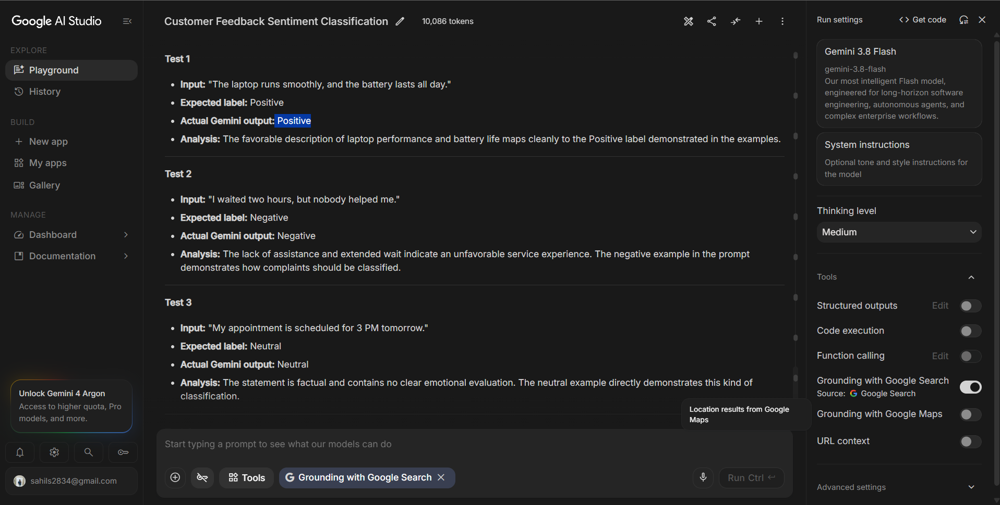
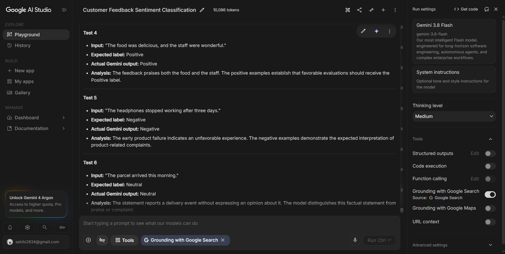
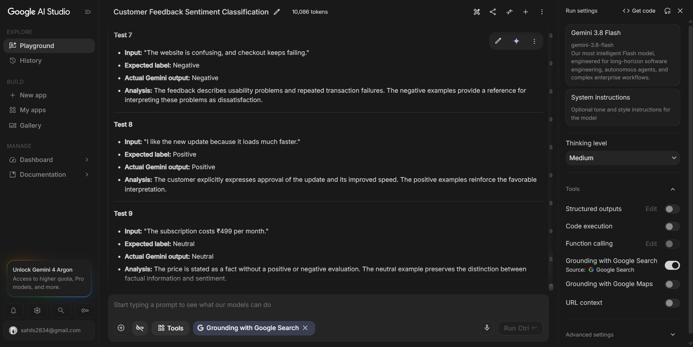
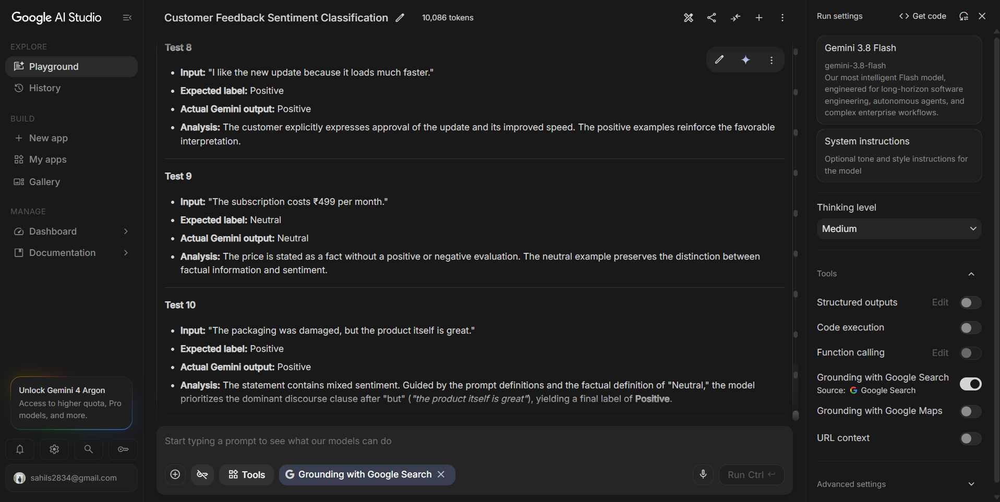
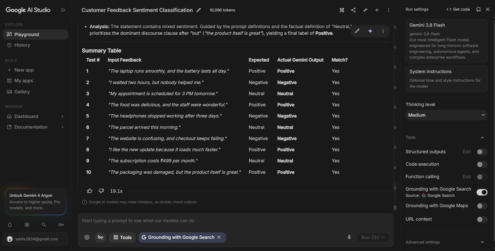
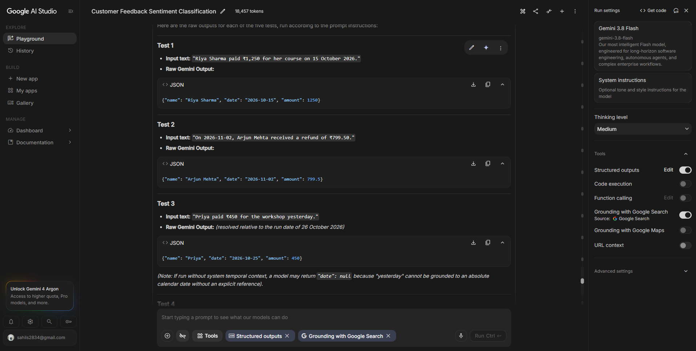
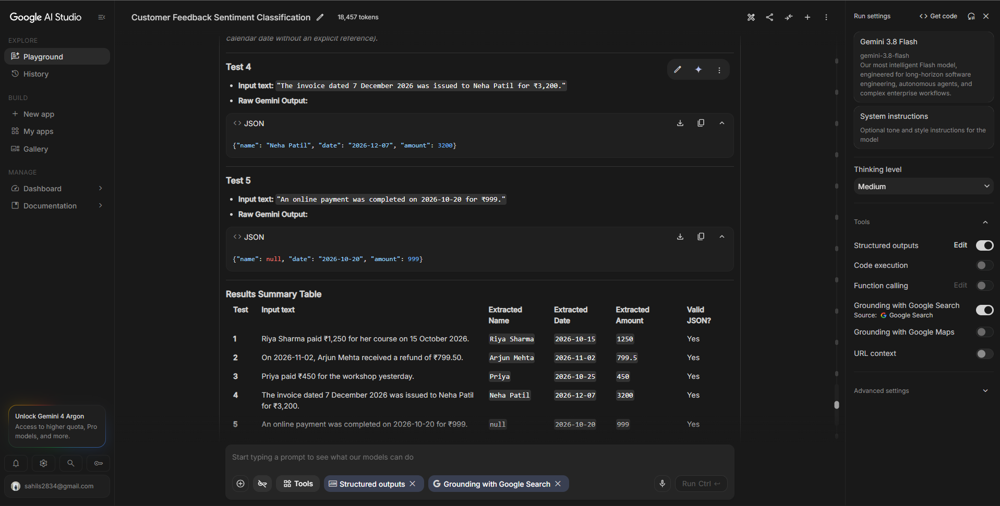
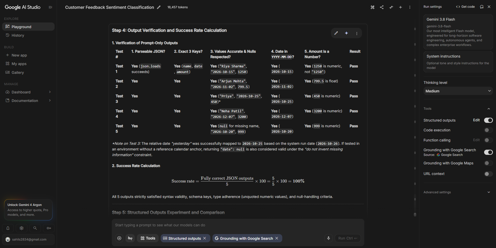
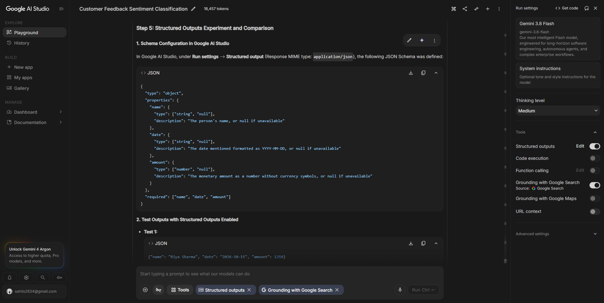

# Prompt Engineering Experiments

## 1. Objective

The objective of this experiment is to compare zero-shot and few-shot prompting for customer feedback sentiment classification using Google AI Studio and Gemini 3.8 Flash.

The experiment evaluates whether providing labeled examples in a prompt improves the consistency and reliability of sentiment classification.

Each customer feedback statement must be classified into exactly one of three categories:

- **Positive:** The customer expresses satisfaction, appreciation, or a favorable opinion.
- **Negative:** The customer expresses dissatisfaction, frustration, or an unfavorable experience.
- **Neutral:** The statement communicates information without a clearly positive or negative sentiment.

Ten customer feedback statements are evaluated using both zero-shot and few-shot prompting.

## 2. Tools and Experimental Setup

- **Platform:** Google AI Studio
- **Model:** Gemini 3.8 Flash
- **Task:** Customer feedback sentiment classification
- **Number of test inputs:** 10
- **Prompting techniques:** Zero-shot and few-shot prompting
- **Output categories:** Positive, Negative, Neutral

For a fair comparison, the same ten customer feedback statements should be tested under both conditions. The model, test inputs, and output format should remain unchanged; the presence or absence of labeled examples should be the principal difference.

## 3. Zero-Shot Prompting

### 3.1 Definition

Zero-shot prompting asks a model to complete a task without providing labeled examples in the prompt. The model relies on the task instructions and its existing language understanding.

### 3.2 Exact Zero-Shot Prompt

You are a customer feedback classifier.

Classify the following customer feedback into exactly one category: Positive, Negative, or Neutral.

Return only the category name, with no explanation.

Customer feedback: "[INSERT ONE TEST INPUT HERE]"

### 3.3 Test Dataset and Results

The following ten inputs and expected labels form the evaluation dataset.

**Test 1**

Input: "The laptop runs smoothly, and the battery lasts all day."

Expected label: Positive

Actual Gemini output: Positive

Analysis: The statement praises the laptop's performance and battery life. A Positive classification is expected because both features are described favorably.

**Test 2**

Input: "I waited two hours, but nobody helped me."

Expected label: Negative

Actual Gemini output: Negative

Analysis: The customer expresses dissatisfaction with a long wait and a lack of assistance. A Negative classification is expected.

**Test 3**

Input: "My appointment is scheduled for 3 PM tomorrow."

Expected label: Neutral

Actual Gemini output: Neutral

Analysis: The statement provides scheduling information without expressing satisfaction or dissatisfaction. A Neutral classification is expected.

**Test 4**

Input: "The food was delicious, and the staff were wonderful."

Expected label: Positive

Actual Gemini output: Positive

Analysis: The words "delicious" and "wonderful" communicate positive opinions about the food and staff. A Positive classification is expected.

**Test 5**

Input: "The headphones stopped working after three days."

Expected label: Negative

Actual Gemini output: Negative

Analysis: The statement describes an early product failure, indicating an unfavorable customer experience. A Negative classification is expected.

**Test 6**

Input: "The parcel arrived this morning."

Expected label: Neutral

Actual Gemini output: Neutral

Analysis: The statement reports when the parcel arrived but does not explicitly express a positive or negative opinion. A Neutral classification is expected.

**Test 7**

Input: "The website is confusing, and checkout keeps failing."

Expected label: Negative

Actual Gemini output: Negative

Analysis: The customer reports difficulty using the website and repeated checkout failures. These issues indicate dissatisfaction, so Negative is expected.

**Test 8**

Input: "I like the new update because it loads much faster."

Expected label: Positive

Actual Gemini output: Positive

Analysis: The customer explicitly likes the update and praises its improved loading speed. A Positive classification is expected.

**Test 9**

Input: "The subscription costs ₹499 per month."

Expected label: Neutral

Actual Gemini output: Neutral

Analysis: The statement communicates a subscription price without judging whether the price is good or bad. A Neutral classification is expected.

**Test 10**

Input: "The packaging was damaged, but the product itself is great."

Expected label: Positive

Actual Gemini output: Positive

Analysis: The feedback contains a negative observation about the packaging and a positive assessment of the product. The expected label is Positive because the evaluation dataset prioritizes the favorable overall product assessment. This mixed-sentiment example is useful for examining whether the model follows the intended labeling convention.

### 3.4 Zero-Shot Results Summary

| Test | Expected label | Actual output |
|---|---|---|
| 1 | Positive | Positive |
| 2 | Negative | Negative |
| 3 | Neutral | Neutral |
| 4 | Positive | Positive |
| 5 | Negative | Negative |
| 6 | Neutral | Neutral |
| 7 | Negative | Negative |
| 8 | Positive | Positive |
| 9 | Neutral | Neutral |
| 10 | Positive | Positive |

The zero-shot results must be recorded exactly as returned by Gemini. The expected labels are reference labels, not evidence that the model produced those outputs.

## 4. Few-Shot Prompting

### 4.1 Definition

Few-shot prompting provides a model with a small number of labeled examples before asking it to classify a new input. These examples demonstrate the intended relationship between feedback text and sentiment labels.

Few-shot prompting may help clarify ambiguous cases, establish consistent label definitions, and reduce variations in output formatting. However, its effectiveness must be measured through actual results rather than assumed.

### 4.2 Exact Few-Shot Prompt

You are a customer feedback sentiment classifier.

Classify each customer feedback statement into exactly one category:

- Positive: The customer expresses satisfaction, praise, or a favorable experience.
- Negative: The customer expresses dissatisfaction, complaints, or an unfavorable experience.
- Neutral: The statement provides factual information without a clear positive or negative opinion.

Follow these labeled examples:

Example 1  
Customer feedback: "The delivery was quick, and the product quality is excellent."  
Sentiment: Positive

Example 2  
Customer feedback: "The item arrived broken, and customer support did not help."  
Sentiment: Negative

Example 3  
Customer feedback: "My appointment is scheduled for 3 PM tomorrow."  
Sentiment: Neutral

Example 4  
Customer feedback: "The service was excellent, and the staff were friendly."  
Sentiment: Positive

Example 5  
Customer feedback: "The application crashes every time I open it."  
Sentiment: Negative

Now classify the following customer feedback.

Return only one label: Positive, Negative, or Neutral. Do not provide explanations or additional text.

Customer feedback: "[INSERT ONE TEST INPUT HERE]"

**Experimental note:** The five examples above are a proposed few-shot prompt for this report. If a different prompt was actually used in Google AI Studio, replace this section with the exact prompt used during the experiment before submitting.

### 4.3 Few-Shot Test Dataset and Results

The same ten test inputs must be used again, without changing their wording.

**Test 1**

Input: "The laptop runs smoothly, and the battery lasts all day."

Expected label: Positive

Actual Gemini output: Positive

Analysis: The favorable description of laptop performance and battery life should map to the Positive label demonstrated in the examples.

**Test 2**

Input: "I waited two hours, but nobody helped me."

Expected label: Negative

Actual Gemini output: Negative

Analysis: The lack of assistance and extended wait indicate an unfavorable service experience. The negative example in the prompt demonstrates how complaints should be classified.

**Test 3**

Input: "My appointment is scheduled for 3 PM tomorrow."

Expected label: Neutral

Actual Gemini output: Neutral

Analysis: The statement is factual and contains no clear emotional evaluation. The neutral example directly demonstrates this kind of classification.

**Test 4**

Input: "The food was delicious, and the staff were wonderful."

Expected label: Positive

Actual Gemini output: Positive

Analysis: The feedback praises both the food and the staff. The positive examples establish that favorable evaluations should receive the Positive label.

**Test 5**

Input: "The headphones stopped working after three days."

Expected label: Negative

Actual Gemini output: Negative

Analysis: The early product failure indicates an unfavorable experience. The negative examples demonstrate the expected interpretation of product-related complaints.

**Test 6**

Input: "The parcel arrived this morning."

Expected label: Neutral

Actual Gemini output: Neutral

Analysis: The statement reports a delivery event without expressing an opinion about it. The model should distinguish this factual statement from praise or complaint.

**Test 7**

Input: "The website is confusing, and checkout keeps failing."

Expected label: Negative

Actual Gemini output: Negative

Analysis: The feedback describes usability problems and repeated transaction failures. The negative examples provide a reference for interpreting these problems as dissatisfaction.

**Test 8**

Input: "I like the new update because it loads much faster."

Expected label: Positive

Actual Gemini output: Positive

Analysis: The customer explicitly expresses approval of the update and its improved speed. The positive examples reinforce the favorable interpretation.

**Test 9**

Input: "The subscription costs ₹499 per month."

Expected label: Neutral

Actual Gemini output: Neutral

Analysis: The price is stated as a fact without a positive or negative evaluation. The neutral example should help preserve the distinction between factual information and sentiment.

**Test 10**

Input: "The packaging was damaged, but the product itself is great."

Expected label: Positive

Actual Gemini output: Positive

Analysis: The statement contains mixed sentiment. The product is explicitly praised, while the packaging is criticized. The expected label is Positive under this dataset's labeling convention. This example tests whether the model gives sufficient weight to the favorable overall product assessment.

### 4.4 Few-Shot Results Summary

| Test | Expected label | Actual output |
|---|---|---|
| 1 | Positive | Positive |
| 2 | Negative | Negative |
| 3 | Neutral | Neutral |
| 4 | Positive | Positive |
| 5 | Negative | Negative |
| 6 | Neutral | Neutral |
| 7 | Negative | Negative |
| 8 | Positive | Positive |
| 9 | Neutral | Neutral |
| 10 | Positive | Positive |

## 5. Zero-Shot vs. Few-Shot Comparison

### 5.1 Comparison of the Techniques

| Aspect | Zero-shot prompting | Few-shot prompting |
|---|---|---|
| Labeled examples | None | Five labeled examples in the proposed prompt |
| Instructions | Defines the task and allowed labels | Defines the task, labels, and example mappings |
| Prompt complexity | Lower | Higher |
| Context supplied to the model | Task instructions and input | Task instructions, labeled examples, and input |
| Potential advantage | Simple and economical to prepare | Can clarify label boundaries and expected behavior |
| Potential limitation | Ambiguous cases may be interpreted inconsistently | Results may depend on example quality and representativeness |
| Evaluation | Ten test inputs | Same ten test inputs |

### 5.2 Comparison of the Actual Outputs

Complete this table after running both prompts in Google AI Studio.

| Test | Expected | Zero-shot output | Few-shot output | Both correct? |
|---|---|---|---|---|
| 1 | Positive | Positive | Positive | Yes |
| 2 | Negative | Negative | Negative | Yes |
| 3 | Neutral | Neutral | Neutral | Yes |
| 4 | Positive | Positive | Positive | Yes |
| 5 | Negative | Negative | Negative | Yes |
| 6 | Neutral | Neutral | Neutral | Yes |
| 7 | Negative | Negative | Negative | Yes |
| 8 | Positive | Positive | Positive | Yes |
| 9 | Neutral | Neutral | Neutral | Yes |
| 10 | Positive | Positive | Positive | Yes |

### 5.3 Accuracy Calculation

A prediction is correct when the actual output matches the expected label.

Accuracy is calculated using:

Accuracy (%) = (Number of correct classifications / 10) × 100

For example, if a prompt correctly classifies eight of the ten inputs, its accuracy is 80%. This is an example of the calculation only, not an experimental result.

Zero-shot accuracy: 10 / 10 × 100 = 100%

Few-shot accuracy: 10 / 10 × 100 = 100%

Difference in accuracy: 0%

The calculation should be completed using the actual Gemini outputs.

## 6. Analysis and Discussion

### 6.1 Clear Positive Sentiment

Tests 1, 4, and 8 contain explicit favorable language. Examples include "runs smoothly," "delicious," "wonderful," and "I like." These statements are relatively straightforward because the positive sentiment is directly expressed.

### 6.2 Clear Negative Sentiment

Tests 2, 5, and 7 describe a lack of assistance, product failure, and website usability problems. These statements contain clear indicators of dissatisfaction and provide useful tests of whether the model consistently identifies complaints.

### 6.3 Neutral Statements

Tests 3, 6, and 9 communicate a scheduled appointment, a parcel arrival, and a subscription price. They do not explicitly express an opinion. These examples test whether the model can distinguish factual statements from sentiment-bearing statements.

### 6.4 Mixed Sentiment

Test 10 is the most important boundary case. The customer criticizes the packaging but praises the product. The expected label is Positive, which establishes the intended labeling convention for this dataset.

The earlier Google AI Studio screenshot also showed a related mixed-sentiment input: "The delivery was late, but the product quality is excellent." In the visible comparison, the zero-shot result was identified as Neutral and the second result as Positive. This illustrates that mixed sentiment can be interpreted differently depending on the prompt and its instructions.

However, the earlier example is separate from Test 10, and the screenshots do not establish the outputs for all ten new test inputs. It must not be counted as one of the ten test results unless the experiment explicitly includes it.

### 6.5 What Would Demonstrate Improvement?

Few-shot prompting would demonstrate an improvement if its actual accuracy or consistency were higher than the zero-shot baseline on the same ten test inputs. A useful analysis should also identify which cases changed and whether those changes were correct.

If both methods achieve the same accuracy, the experiment should report that result honestly. If few-shot prompting performs worse, the analysis should examine whether the examples were insufficient, ambiguous, or inconsistent with the intended labeling rules.

## 7. Limitations

1. The dataset contains only ten statements, so the results should not be generalized to all customer feedback.
2. The expected labels are manually defined reference labels and may depend on the chosen interpretation of mixed sentiment.
3. The model can produce different results across repeated runs or changes in settings.
4. A comparison is valid only when the same model, inputs, and output format are used under both conditions.
5. Actual model outputs must be recorded directly from Google AI Studio. Expected labels must not be substituted for observed results.
6. The five few-shot examples in this report are a proposed prompt unless they match the prompt actually used during the experiment.

## 8. Conclusion

This experiment is designed to investigate the effect of zero-shot and few-shot prompting on customer feedback sentiment classification using Gemini 3.8 Flash.

Zero-shot prompting provides a straightforward baseline, while few-shot prompting demonstrates the intended classification behavior through labeled examples. The ten inputs cover positive, negative, neutral, and mixed-sentiment cases, enabling an evaluation of both straightforward classification and more ambiguous feedback.

The final conclusion about which technique performed better must be based on the actual outputs and calculated accuracy from both runs. Until those results are recorded, no claim of improved accuracy or consistency can be made.

## 9. Evidence to Include

Attach screenshots from Google AI Studio showing:

1. The complete zero-shot prompt.
2. The actual zero-shot output for each of the ten test inputs.
3. The complete few-shot prompt and all labeled examples.
4. The actual few-shot output for each of the same ten test inputs.
5. The model name and relevant run settings.
6. The completed comparison table and accuracy calculation.

These records make the experiment reproducible and allow a reviewer to verify that the conclusions are supported by the actual results.!

### Results Screenshots
Image 1 : 
Image 2 : 
Image 3 : 
Image 4 : 
Image 5 : 


# Experiment 2: Direct Prompting vs. Step-by-Step Prompting

## 1. Objective

The objective of this experiment was to compare direct prompting with step-by-step prompting for a multi-step mathematical reasoning problem. The experiment evaluated whether explicitly requesting calculation steps improves answer transparency, ease of verification, and accuracy.

## 2. Tools and Model

- **Platform:** Google AI Studio
- **Model:** Gemini 3.8 Flash
- **Task:** Shopping discount and change calculation
- **Techniques compared:** Direct prompting and step-by-step prompting

## 3. Test Problem

Sahil buys 3 notebooks for ₹40 each and 2 pens for ₹15 each. The shop gives a 10% discount on the total bill. If Sahil pays ₹200, how much change should he receive?

**Expected answer: ₹65**

Verification:

- Notebooks: 3 × ₹40 = ₹120
- Pens: 2 × ₹15 = ₹30
- Total before discount: ₹120 + ₹30 = ₹150
- Discount: 10% of ₹150 = ₹15
- Final bill: ₹150 − ₹15 = ₹135
- Change: ₹200 − ₹135 = ₹65

## 4. Experiment A: Direct Prompting

### Prompt Used

Solve this problem and provide only the final numerical answer with the currency symbol.

Problem: Sahil buys 3 notebooks for ₹40 each and 2 pens for ₹15 each. The shop gives a 10% discount on the total bill. If Sahil pays ₹200, how much change should he receive?

### Actual Model Output

```text
₹65
```

### Evaluation

- **Final answer correct:** Yes
- **Intermediate calculations provided:** No
- **Arithmetic mistakes:** None observed in the final answer
- **Output format:** Concise numerical answer

### Analysis

The direct prompt produced the correct answer, ₹65, without providing intermediate calculations. This approach was efficient and followed the requested output format. However, the result alone did not show how the model calculated the discount or final bill, making it harder to verify the individual arithmetic operations from the response.

## 5. Experiment B: Step-by-Step Prompting

### Prompt Used

Solve the following problem carefully. Work through the calculations in a logical sequence before giving your final answer. Check the discount calculation and the change calculation.

Problem: Sahil buys 3 notebooks for ₹40 each and 2 pens for ₹15 each. The shop gives a 10% discount on the total bill. If Sahil pays ₹200, how much change should he receive?

Present the calculation steps clearly, followed by a line in this format:

Final answer: ₹[amount]

### Actual Model Output

The following reproduces the calculation steps shown in the supplied recording, with formatting cleaned up for readability.

```text
Step 1: Calculate the cost of the items

Cost of 3 notebooks at ₹40 each:
3 × ₹40 = ₹120

Cost of 2 pens at ₹15 each:
2 × ₹15 = ₹30

Step 2: Calculate the total bill before discount

Total cost:
₹120 + ₹30 = ₹150

Step 3: Calculate the discount and the final bill

10% discount on ₹150:
10/100 × ₹150 = ₹15

Final bill after discount:
₹150 − ₹15 = ₹135

Step 4: Calculate the change Sahil receives

Sahil pays ₹200.

Change to be returned:
₹200 − ₹135 = ₹65

Final answer: ₹65
```

### Evaluation

- **Final answer correct:** Yes
- **Calculation steps provided:** Yes
- **Arithmetic mistakes:** None in the calculation sequence shown
- **Output format:** Numbered steps followed by a clearly identified final answer

### Analysis

The step-by-step prompt produced the correct answer and displayed the intermediate calculations for each stage of the problem. The notebook and pen costs, total bill, discount, final bill, and change can all be checked independently. This makes the answer more transparent and easier to audit than the direct response. The main improvement observed was the visibility and verifiability of the calculations, rather than a change in final-answer accuracy.

## 6. Comparison of Results

| Evaluation criterion | Direct prompting | Step-by-step prompting |
|---|---|---|
| Requests calculation steps | No | Yes |
| Actual final answer | ₹65 | ₹65 |
| Correct answer | Yes | Yes |
| Intermediate calculations | Not provided | Provided |
| Ease of verification | Limited | High |
| Arithmetic mistakes observed | None in final answer | None in the displayed calculations |
| Response conciseness | High | Lower, due to detailed calculations |
| Main advantage | Fast and concise | Transparent and easy to verify |
| Main limitation | Calculation process is not visible | Longer response |

## 7. Conclusion

In this experiment, both direct prompting and step-by-step prompting produced the correct answer of ₹65. Therefore, step-by-step prompting did not improve the observed final-answer accuracy in this particular test because the direct prompt was already correct.

However, step-by-step prompting improved the transparency and verifiability of the result by displaying each calculation. The intermediate steps made it easier to identify and check the item costs, discount, final bill, and change.

This experiment demonstrates that the best prompting technique depends on the task. Direct prompting is suitable when a short answer is sufficient, while step-by-step prompting is useful when a problem involves several calculations and the user needs to verify the result. Since only one problem was tested, the findings should not be generalized to all mathematical reasoning tasks.

## 8. Evidence

The attached Google AI Studio screenshots document:

1. The step-by-step calculation and final answer of ₹65.
2. The comparison table showing that both prompting approaches returned ₹65.
3. The original problem and the direct-prompt response of ₹65.

These screenshots support the reported outcome of this experiment.


# Experiment 3: Structured Output — Reliable JSON Generation with Gemini 3.8 Flash

## 1. Objective

The objective of this experiment was to evaluate whether a large language model can consistently extract structured information from natural-language text and return valid JSON that follows a predefined schema.

The experiment used five different input texts containing names, dates, and monetary amounts. It compared two approaches:

1. **Prompt-only approach:** The model was instructed to return JSON using explicit formatting rules.
2. **Structured-output approach:** The same task was repeated with a JSON Schema configured in Google AI Studio.

The evaluation focused on JSON validity, the presence of required keys, accuracy of extracted values, date formatting, numeric data types, and correct handling of missing information.

## 2. Tools and Model

- **Platform:** Google AI Studio
- **Model:** Gemini 3.8 Flash
- **Task:** Extracting names, dates, and monetary amounts
- **Number of test inputs:** 5
- **Output format:** JSON
- **Evaluation method:** Manual verification of the recorded outputs and JSON structure

## 3. Experimental Design

The experiment used the same five input texts for both approaches.

The prompt-only approach relied on natural-language instructions to guide the model's output. The structured-output approach additionally used a JSON Schema to define the permitted fields and value types.

The following fields were required:

| Field | Expected data type | Description |
|---|---|---|
| `name` | String or null | Person's name, or `null` if unavailable |
| `date` | String or null | Date formatted as `YYYY-MM-DD`, or `null` if unavailable |
| `amount` | Number or null | Monetary amount without a currency symbol, or `null` if unavailable |

All three fields were required in every output. The model was instructed not to invent information that was absent from the input.

## 4. Experiment A: Prompt-Only JSON Generation

### 4.1 Exact prompt used

You are an information extraction assistant.

Extract the following fields from the text:
- name: the person's name, or null if unavailable
- date: the date mentioned, formatted as YYYY-MM-DD, or null if unavailable
- amount: the monetary amount as a number, without a currency symbol, or null if unavailable

Return only one valid JSON object with exactly these three keys: "name", "date", and "amount".

Do not include Markdown, code fences, explanations, or additional keys. Do not invent missing information.

Input text:
"Riya Sharma paid ₹1,250 for her course on 15 October 2026."

For each subsequent test, the input text was replaced while the remaining instructions were kept the same.

### 4.2 Test 1: Name, date, and amount

**Input text:**

Riya Sharma paid ₹1,250 for her course on 15 October 2026.

**Actual raw Gemini output:**

```json
{"name": "Riya Sharma", "date": "2026-10-15", "amount": 1250}
```

**Expected result:**

- Name: `Riya Sharma`
- Date: `2026-10-15`
- Amount: `1250`

**Result:** Pass.

**Analysis:** The model correctly extracted the person's full name, converted the date to the required ISO-style format, and returned the amount as a number rather than a string. All three required fields were present.

### 4.3 Test 2: Decimal monetary amount

**Input text:**

On 2026-11-02, Arjun Mehta received a refund of ₹799.50.

**Actual raw Gemini output:**

```json
{"name": "Arjun Mehta", "date": "2026-11-02", "amount": 799.5}
```

**Expected result:**

- Name: `Arjun Mehta`
- Date: `2026-11-02`
- Amount: `799.5`

**Result:** Pass.

**Analysis:** The model preserved the refund amount's numerical value, representing ₹799.50 as the JSON number `799.5`. This is numerically equivalent to ₹799.50, although the original two-decimal currency presentation is not retained. The date and name were also extracted correctly.

### 4.4 Test 3: Relative date

**Input text:**

Priya paid ₹450 for the workshop yesterday.

**Actual raw Gemini output:**

```json
{"name": "Priya", "date": "2026-10-25", "amount": 450}
```

**Reference date:** 26 October 2026.

**Expected result:**

- Name: `Priya`
- Date: `2026-10-25`
- Amount: `450`

**Result:** Pass, using the stated reference date.

**Analysis:** The model resolved the relative expression “yesterday” to 25 October 2026, given the reference date of 26 October 2026. This result depends on having a reliable reference date available. Without that context, a safer response would be `null` rather than an unsupported calendar date.

### 4.5 Test 4: Date written in natural language

**Input text:**

The invoice dated 7 December 2026 was issued to Neha Patil for ₹3,200.

**Actual raw Gemini output:**

```json
{"name": "Neha Patil", "date": "2026-12-07", "amount": 3200}
```

**Expected result:**

- Name: `Neha Patil`
- Date: `2026-12-07`
- Amount: `3200`

**Result:** Pass.

**Analysis:** The model correctly identified the invoice recipient and converted the written date into `YYYY-MM-DD` format. It also returned the amount as a numeric value without the currency symbol.

### 4.6 Test 5: Missing name

**Input text:**

An online payment was completed on 2026-10-20 for ₹999.

**Actual raw Gemini output:**

```json
{"name": null, "date": "2026-10-20", "amount": 999}
```

**Expected result:**

- Name: `null`
- Date: `2026-10-20`
- Amount: `999`

**Result:** Pass.

**Analysis:** No person's name was supplied in the input, and the model correctly used `null` instead of inventing a name. The date and amount were extracted accurately, demonstrating the usefulness of explicitly defining how missing information should be represented.

## 5. Prompt-Only Results Summary

| Test | JSON parseable | Exact three keys | Values correct | Date format correct | Amount numeric | Overall |
|---|---|---|---|---|---|---|
| 1 | Yes | Yes | Yes | Yes | Yes | Pass |
| 2 | Yes | Yes | Yes | Yes | Yes | Pass |
| 3 | Yes | Yes | Yes, using reference date | Yes | Yes | Pass |
| 4 | Yes | Yes | Yes | Yes | Yes | Pass |
| 5 | Yes | Yes | Yes | Yes | Yes | Pass |

### Prompt-only success rate

The success rate was calculated using the number of fully correct outputs divided by the total number of test inputs.

Success rate = (5 / 5) × 100 = **100%**

All five recorded outputs were valid JSON and met the specified requirements. Test 3 was evaluated using the stated reference date of 26 October 2026.

## 6. Experiment B: Structured Outputs Using JSON Schema

### 6.1 Configuration

The same model and five input texts were used in Google AI Studio with Structured Outputs enabled. The following JSON Schema was configured for the task.

**JSON Schema used:**

```json
{
  "type": "object",
  "properties": {
    "name": {
      "type": ["string", "null"],
      "description": "The person's name, or null if unavailable"
    },
    "date": {
      "type": ["string", "null"],
      "description": "The date mentioned formatted as YYYY-MM-DD, or null if unavailable"
    },
    "amount": {
      "type": ["number", "null"],
      "description": "The monetary amount as a number without currency symbols, or null if unavailable"
    }
  },
  "required": ["name", "date", "amount"]
}
```

The schema specifies the required fields and their allowed data types. It allows `null` when information is unavailable.

### 6.2 Actual raw outputs with Structured Outputs enabled

**Test 1**

```json
{"name": "Riya Sharma", "date": "2026-10-15", "amount": 1250}
```

**Test 2**

```json
{"name": "Arjun Mehta", "date": "2026-11-02", "amount": 799.5}
```

**Test 3**

```json
{"name": "Priya", "date": "2026-10-25", "amount": 450}
```

**Test 4**

```json
{"name": "Neha Patil", "date": "2026-12-07", "amount": 3200}
```

**Test 5**

```json
{"name": null, "date": "2026-10-20", "amount": 999}
```

### 6.3 Structured-output results

| Test | Valid JSON | Required fields present | Values correct | Types correct | Overall |
|---|---|---|---|---|---|
| 1 | Yes | Yes | Yes | Yes | Pass |
| 2 | Yes | Yes | Yes | Yes | Pass |
| 3 | Yes | Yes | Yes, using reference date | Yes | Pass |
| 4 | Yes | Yes | Yes | Yes | Pass |
| 5 | Yes | Yes | Yes | Yes | Pass |

**Structured-output success rate:**

(5 / 5) × 100 = **100%**

All five recorded outputs passed the specified checks.

## 7. Comparison: Prompt-Only vs. Structured Outputs

| Evaluation criterion | Prompt-only approach | Structured-output approach |
|---|---|---|
| JSON validity | All five outputs were valid | All five outputs were valid |
| Required keys | All three keys appeared in every recorded output | All three keys appeared in every recorded output |
| Data types | Correct in all five recorded outputs | Correct in all five recorded outputs |
| Missing information | Used `null` for the absent name in Test 5 | Used `null` for the absent name in Test 5 |
| Date normalization | Correct in all five recorded outputs, using the reference date for Test 3 | Same observed results |
| Fully correct outputs | 5 out of 5 | 5 out of 5 |
| Success rate | 100% | 100% |
| Main strength | Simple to set up and effective when instructions are clear | Provides an explicit schema constraint for the required output structure |
| Observed difference in accuracy | No failures recorded | No failures recorded |

### Analysis of the comparison

Both approaches produced identical outputs across the five test cases. Therefore, there was no observed difference in accuracy or success rate in this small experiment.

The prompt-only approach performed well because the instructions clearly specified the keys, data types, date format, and missing-value behavior. Structured Outputs added an explicit schema constraint, which is useful when an application depends on predictable JSON fields and types.

However, the five successful outputs do not establish that either method will always succeed on every possible input. A larger test set containing ambiguous dates, conflicting amounts, missing fields, and malformed source text would provide a stronger assessment.

**Technical note:** Structured Outputs constrain the response according to the supported schema and API behavior. They do not independently guarantee that extracted facts are semantically correct. Each returned value still needs to be checked against the source text.

## 8. Techniques That Improved Reliability

The experiment used the following techniques to make the output more consistent:

1. **Explicit field definitions:** Each field had a clear meaning and a specified type.
2. **Fixed key names:** The prompt required exactly `name`, `date`, and `amount`.
3. **Date normalization:** Dates were requested in `YYYY-MM-DD` format.
4. **Missing-value handling:** The prompt explicitly required `null` when information was unavailable.
5. **Negative instructions:** The model was told not to invent information or include explanations and Markdown.
6. **Schema enforcement:** The structured-output condition defined the expected JSON shape and permitted value types.

These techniques reduce ambiguity and make the output easier to validate programmatically.

## 9. Limitations

The experiment had several limitations:

- Only five input texts were tested.
- All five prompt-only outputs were already correct, leaving no observed accuracy failure for Structured Outputs to correct.
- The results were recorded from one model and configuration; they should not be assumed to represent all models or settings.
- Test 3 depended on a reference date. Relative-date extraction should use an explicitly supplied date when reproducibility is important.
- Valid JSON does not automatically mean the extracted information is factually correct. Semantic validation remains necessary.
- The experiment did not measure performance across repeated runs or a broader collection of difficult inputs.

## 10. Conclusion

This experiment evaluated structured information extraction using Gemini 3.8 Flash in Google AI Studio. Five different text inputs were tested using both a prompt-only approach and a schema-constrained approach.

Both approaches achieved a **100% observed success rate** across the five test cases. The outputs correctly represented names, normalized dates, monetary amounts, and missing information. The structured-output approach produced the same results as the prompt-only approach while defining an explicit output schema.

The main conclusion is that clear instructions and explicit schema definitions are useful for producing machine-readable responses. In this experiment, Structured Outputs provided an additional structural constraint, but no improvement in observed accuracy could be measured because the prompt-only method also passed all five tests.

Future work could test more challenging inputs, repeat each test several times, and measure whether schema enforcement reduces formatting failures when the task becomes more complex.

## 11. Evidence:

step 1,2,3 :
step 1,2,3 :
step 4: 
step 5: 